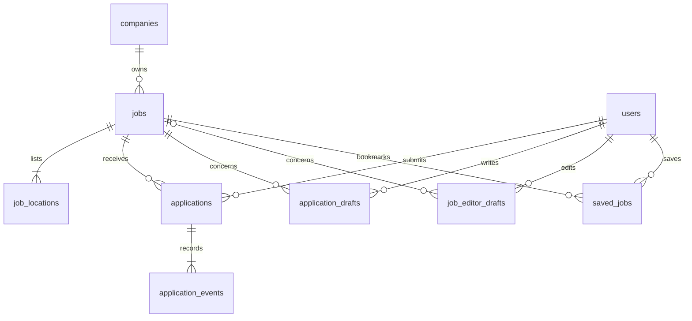

# Relational jobs and applications — schema proposal

Status: approved and implemented on 2026-11-17; local verification complete.

## Request and approval boundary

On 2026-11-17 the user requested a new branch for job and related-application databases, with a schema proposal for approval before implementation. Branch: `codex/jobs-applications-schema`, based on main `8c14b81`.

The user explicitly accepted this schema and authorized implementation on 2026-11-17. The pre-approval document was the only prior change. Implement the approved schema and lossless migration while preserving existing accounts, passwords, sessions and live records.

## Verified current model

- `server/database.ts` already uses `.data/doroboty.sqlite` (or DATABASE_PATH). `users`, `sessions` and `login_failures` are relational; one `scenario.data` JSON document holds companies, people, jobs, applications, saved jobs and both draft collections.
- `src/features/prototype/model.ts` supplies the current Zod shapes, identifiers, ownership rules and recruitment transitions. Each application references one job, one candidate and the same company as its job. There is at most one application per candidate/job, including terminal applications.
- Submission snapshots candidate name/CV, job title, approved answer, prepared scenario score/summary and optionally the complete approved PR02 card and responses. It does not currently snapshot every job/company field.
- `competency.ts` and `job-editor-state.ts` define complete approved cards/submissions and intentionally incomplete drafts. Old or removed-criterion responses and source/generated text must survive migration.

Reviewed FEATURES.md: AUTH-03/04, PUB-02/04/06, CAN-08/09/10/13/15/16, EMP-02/03/04/05/08/09 and SYS-02/09/10. This proposal changes no implemented behavior; the register does not need an implementation update yet.

## Recommended storage boundary

Use one existing SQLite database with two main relational aggregates, `jobs` and `applications`, and their supporting tables. A foreign key links each application to its job. This keeps related records in the same transaction and retains the Node 24/no-extra-service setup.

Keep `users`, `sessions` and `login_failures` unchanged. References to a person point to existing `users.person_id`; do not introduce new account IDs, password hashes or registration behavior. Role and employer-company authorization remain server/domain checks against the existing profile data. An account foreign key alone does not prove that an account is a candidate or employer.

Use TEXT for existing IDs (including non-UUID legacy IDs), UTC ISO timestamps and enum values; use INTEGER for positions and scores. Required fields are NOT NULL unless marked optional below. No historical creator, consent time, actor or missing job snapshot is fabricated.

## Main table: jobs

| Column                                                                 | SQLite type / optionality           | Meaning and constraints                                                                                                                                                                                |
| ---------------------------------------------------------------------- | ----------------------------------- | ------------------------------------------------------------------------------------------------------------------------------------------------------------------------------------------------------ |
| `id`                                                                   | TEXT, primary key                   | Preserve the current job ID.                                                                                                                                                                           |
| `slug`                                                                 | TEXT, unique                        | Preserve existing hash-route URLs.                                                                                                                                                                     |
| `company_id`                                                           | TEXT, foreign key                   | References `companies.id`.                                                                                                                                                                             |
| `title`                                                                | TEXT                                | Current title, 1–200 characters.                                                                                                                                                                       |
| `summary`                                                              | TEXT                                | Current summary, 10–12000 characters.                                                                                                                                                                  |
| `description`                                                          | TEXT                                | Current approved description, 30–12000 characters.                                                                                                                                                     |
| `category`                                                             | TEXT                                | `build`, `apply`, `lead`.                                                                                                                                                                              |
| `job_function`                                                         | TEXT                                | `product`, `engineering`, `data`, `design`, `marketing`, `operations`.                                                                                                                                 |
| `remote_status`                                                        | TEXT                                | `onsite`, `hybrid`, `remote`.                                                                                                                                                                          |
| `seniority`                                                            | TEXT                                | `junior`, `mid`, `senior`, `lead`.                                                                                                                                                                     |
| `contract`                                                             | TEXT                                | `employment`, `b2b`, `mandate`.                                                                                                                                                                        |
| `salary_min`, `salary_max`                                             | REAL, optional independently        | Match the current JavaScript numeric model without rounding imported values. Nonnegative; min ≤ max when both exist. A move to integer minor units would require a separately agreed precision policy. |
| `salary_currency`                                                      | TEXT, optional                      | `PLN`, `EUR`.                                                                                                                                                                                          |
| `salary_period`                                                        | TEXT, optional                      | `month`, `year`.                                                                                                                                                                                       |
| `salary_kind`                                                          | TEXT, optional                      | `gross`, `net`.                                                                                                                                                                                        |
| `latitude`, `longitude`                                                | REAL, optional together             | Latitude −90…90 and longitude −180…180; both absent or both supplied.                                                                                                                                  |
| `publication_status`                                                   | TEXT                                | `draft`, `review`, `published`, `hidden`, `expired`, `archived`.                                                                                                                                       |
| `published_at`, `expires_at`                                           | TEXT                                | Preserve existing required ISO timestamp fields, including legacy draft values. Do not infer automatic expiration behavior from these columns.                                                         |
| `verification_status`                                                  | TEXT                                | `unverified`, `editorial`, `employer_verified`.                                                                                                                                                        |
| `source_brief`, `generated_description`, `generated_description_model` | TEXT, optional                      | Keep source/generated history distinct from the approved description. Existing audience restrictions remain.                                                                                           |
| `competency_card_json`                                                 | TEXT containing an object, optional | Complete current approved PR02 card: source description, proposals, selected criteria, approver/time and provenance. Validated by `competencyCardSchema`.                                              |
| `list_position`                                                        | INTEGER                             | Internal storage order for lossless reconstruction of the existing jobs array.                                                                                                                         |

A composite UNIQUE key `(id, company_id)` supports the matching-company foreign key from applications. No company transfer or hard-delete flow is added.

## Main table: applications

| Column                             | SQLite type / optionality           | Meaning and constraints                                                                                                                            |
| ---------------------------------- | ----------------------------------- | -------------------------------------------------------------------------------------------------------------------------------------------------- |
| `id`                               | TEXT, primary key                   | Preserve the current application ID.                                                                                                               |
| `job_id`                           | TEXT, foreign key                   | Required reference to the job.                                                                                                                     |
| `candidate_id`                     | TEXT, foreign key                   | References the existing `users.person_id`; server validates candidate role.                                                                        |
| `company_id`                       | TEXT                                | Together with job_id, references `jobs(id, company_id)`, preventing a mismatched employer.                                                         |
| `job_title_snapshot`               | TEXT                                | Job title at submission.                                                                                                                           |
| `candidate_name_snapshot`          | TEXT                                | Candidate name at submission.                                                                                                                      |
| `cv_snapshot`                      | TEXT                                | Complete submitted CV text, minimum 20 characters. Existing prepared-PDF resolution remains unchanged.                                             |
| `answer_snapshot`                  | TEXT                                | Approved submitted answer, minimum 20 characters.                                                                                                  |
| `competency_snapshot_json`         | TEXT containing an object, optional | Complete submitted PR02 card plus responses/materials, copied independently of the current job card and validated by `competencySubmissionSchema`. |
| `source_notes`, `generated_answer` | TEXT                                | Preserve legacy fields, including empty strings; retain current private/hidden projections.                                                        |
| `score_snapshot`                   | INTEGER                             | Existing prepared scenario score, 0–100; no new assessment/scoring logic.                                                                          |
| `summary_snapshot`                 | TEXT                                | Existing scenario summary at submission.                                                                                                           |
| `stage`                            | TEXT                                | Current stage, using the existing eight values below.                                                                                              |
| `submitted_at`                     | TEXT                                | Exact timestamp of the first existing submitted event; supplied by the server for new applications.                                                |
| `list_position`                    | INTEGER                             | Internal storage order for lossless application-array reconstruction.                                                                              |

Constraints: UNIQUE `(candidate_id, job_id)`; composite FOREIGN KEY `(job_id, company_id)` → `jobs(id, company_id)`. Required references use ON DELETE RESTRICT and ON UPDATE RESTRICT. Withdrawing/rejecting an application does not remove the uniqueness rule or permit a second submission.

Immutable submitted-content columns cannot change through normal application updates. Database update guards should allow only a valid stage update; application identity, relations, snapshots and submission time remain fixed. A privileged, confirmed full-scenario restore/reset can replace rows transactionally under the existing operator boundary.

Current stages remain `submitted`, `reviewed`, `interview_invited`, `first_conversation_held`, `continued`, `rejected`, `withdrawn`, `hired`. Preserve the current transition graph, terminal states, consent requirement and PR02 decision-reason validation. A stage CHECK restricts vocabulary; server validation restricts allowed transitions.

## Supporting tables and remaining metadata

| Table                | Columns and keys                                                                                                                                                                                                              | Purpose                                                                                                                                                                                                                                                                       |
| -------------------- | ----------------------------------------------------------------------------------------------------------------------------------------------------------------------------------------------------------------------------- | ----------------------------------------------------------------------------------------------------------------------------------------------------------------------------------------------------------------------------------------------------------------------------- |
| `companies`          | `id TEXT PK`, `slug TEXT UNIQUE`, `name`, `summary`, `description`, `website_url`, `location`, `size_label`, optional `logo_url`, `list_position INTEGER`                                                                     | Normalize the existing company records so job ownership has a real foreign-key parent. No new company/membership flow.                                                                                                                                                        |
| `job_locations`      | `job_id TEXT FK`, `position INTEGER`, `label TEXT`, PK `(job_id, position)`                                                                                                                                                   | Preserve 1–10 ordered job locations. Count and contiguous-order checks stay in shared domain validation.                                                                                                                                                                      |
| `application_events` | `application_id TEXT FK`, `position INTEGER` (0–29), `stage TEXT`, `at TEXT`, `note TEXT`, PK `(application_id, position)`                                                                                                    | Append-only stage history, including the initial submitted event. Position preserves ordering when timestamps are equal. No unknown historical actors are invented.                                                                                                           |
| `application_drafts` | `candidate_id TEXT FK`, `job_id TEXT FK`, `notes TEXT`, `generated TEXT`, `answer TEXT`, optional `competency_responses_json TEXT`, optional `competency_revision TEXT`, `list_position INTEGER`; PK `(candidate_id, job_id)` | Incomplete candidate responses; preserve removed-criterion answers and legacy fields. Revision is deliberately not a foreign key to the current card.                                                                                                                         |
| `job_editor_drafts`  | `id INTEGER PK`, `employer_id TEXT FK`, optional `job_id TEXT FK`, `draft_json TEXT`, `list_position INTEGER`                                                                                                                 | Keep the complete partial composer state under `jobEditorDraftSchema`, rather than applying published-job requirements to unfinished work. Unique `(employer_id, job_id)` when job_id is non-null; unique employer_id where job_id is null (one new-job draft per recruiter). |
| `saved_jobs`         | `candidate_id TEXT FK`, `job_id TEXT FK`, `list_position INTEGER`; PK `(candidate_id, job_id)`                                                                                                                                | Preserve candidate-specific bookmarks.                                                                                                                                                                                                                                        |
| `prototype_state`    | `id INTEGER PK CHECK(id=1)`, `data TEXT`                                                                                                                                                                                      | Validated residual `{version:1, people:[...]}` with current profiles, roles, company assignments, CV source and scenario examples. Profiles/account lifecycle are outside this migration.                                                                                     |

All supporting person references point to `users.person_id`; roles and company membership are checked in shared Zod/domain validation. All company fields use the current companySchema limits. Internal list positions remain outside the API/export format. SQL NULL represents an absent optional field; it must not replace an existing empty string or empty array.

The existing `scenario` table is replaced after successful migration; do not keep a writable copy of jobs/applications/companies in both JSON and SQL. The read adapter assembles the existing full State from the relational tables and residual profile metadata within a consistent read transaction. Export/import keeps the existing version-1 JSON contract; the database schema version changes independently to 2. Session-derived activePersonId remains unstored.

JSON is retained only for cohesive, versioned PR02 payloads and deliberately incomplete drafts, not as the primary store for job/application rows. Nested approver IDs and card/answer consistency still require the existing complete Zod validation; a JSON-validity CHECK alone is insufficient.

## Index proposal

- `jobs(slug)` UNIQUE; `jobs(id, company_id)` UNIQUE for the composite reference.
- `jobs(publication_status, published_at DESC)` for public offers; `jobs(company_id, publication_status)` for the employer workspace and parent-key lookup.
- `applications(candidate_id, job_id)` UNIQUE for duplicate prevention and own-candidate lookups.
- `applications(company_id, stage, submitted_at DESC)` for company recruiting lists.
- `applications(job_id, company_id, submitted_at DESC)` for applications to a given offer and composite-reference lookups.
- Primary keys cover location/event order, candidate draft lookup and candidate bookmarks. No extra job_id index is needed on job_locations or application_id index on application_events because each is already the leading primary-key field. Add job_id indexes on candidate drafts, saved jobs and employer drafts for parent-reference checks.
- Defer full-text search and index tuning to a measured need; this change does not move current client-side pagination/filter semantics or introduce a search service.

## Lifecycle and access invariants

1. Create an application, copy its submitted material, insert its initial event and remove only its matching candidate draft in one transaction.
2. Change application.stage and append the next application_event in the same transaction. The stage equals the last event; the first event is submitted and matches submitted_at. Events cannot be edited/deleted through normal actions. Complete history validation remains required on import and before commit.
3. A job/company with linked records cannot be hard-deleted. Existing hiding/archiving and terminal recruitment states remain. Full operator reset/import explicitly replaces dependent rows in foreign-key order inside one transaction; it never disables constraints or deletes accounts/sessions.
4. Candidate projections exclude employer event notes; employer projections include submitted CV/answers and exclude private candidate draft/legacy material. Public projections include only published offers and public company facts. Source/model history remains employer-only.
5. Job/profile edits never rewrite submitted snapshots. No new historical hiring-outcome or future-stage evidence enters the interactive database.

## Migration and implementation gates after approval

1. Take a consistent pre-migration SQLite backup and validate the current complete scenario. Use stored records, not a fresh seed, as migration input. Abort on invalid input; do not silently reset or repair it.
2. Introduce a versioned migration runner. Detect version 1, migrate to 2 atomically, skip migration on version 2 and reject unsupported future versions. Replace the current unconditional PRAGMA user_version assignment.
3. Populate companies and jobs, locations, applications/events, drafts and saved rows with original IDs, ordering, optional values, timestamps and JSON snapshots. Preserve users/password hashes, sessions and login limits unchanged. Do not fabricate extra job/consent/actor history absent from the source.
4. Compare reconstructed version-1 State with the original, including all array orders and submitted payloads; check row counts, uniqueness and foreign-key consistency. Only then replace the old scenario table and commit schema version 2. Failure rolls back to the intact version-1 database; retain the backup.
5. Adapt reads/writes/import/export/reset together so there is one source of truth and the existing API/UI/Zod/authorization contracts survive. A fresh empty database follows the same schema-version path and seeds only if genuinely empty; restarting a populated database never reseeds it.
6. Test migration rollback/reopen/idempotence, schema guards, missing/foreign job references, duplicate submission, immutable snapshots/history, account/role isolation, old-card draft recovery, import/reset and legacy JSON round trips. Use disposable test databases; do not mutate the live scenario for verification.
7. Update current FEATURES.md/architecture documentation for the implemented behavior, run `./scripts/verify` and perform a separate review before any merge. No UI redesign, external database service, binary upload or authentication rewrite is proposed.

Acceptance means approval of the single-SQLite topology, these main/supporting tables, preserved JSON snapshot/draft boundaries, deletion/uniqueness rules and lossless migration. The user accepted this concrete proposal on 2026-11-17; implementation evidence is recorded below.

## Pre-approval verification (historical)

Only this proposal document was added. No new schema, migration or SQL repository has been implemented or executed. A separate proposal review checked field coverage against the current Zod models, matching-company foreign keys, immutable snapshots, ordered history, optional/empty-value preservation, draft recovery and unchanged account/session boundaries.

`./scripts/verify` passed on Node 24.22.3 using PROTOTYPE_TEST_PORT=3179 and the already provisioned Chromium: 64 unit/integration tests, 69 browser journeys, 10 reference tests, formatting, lint, types, baseline packet and build. The browser run used the separate `.data/e2e-3179.sqlite` test database. No live-scenario migration or reset was performed. Existing non-fatal Zod annotation and bundle-size build notices remain. These checks validate the existing application and documentation hygiene; they do not validate or implement the proposed schema.

FEATURES.md was reviewed without an implementation update. The only changed source-tree file is this document; no UI, authentication, API or database-runtime files changed. At that pre-approval stage, implementation and migration tests remained pending. The approved implementation is described below.

SQLite design references: [foreign-key constraints](https://www.sqlite.org/foreignkeys.html) and [CREATE TABLE constraints](https://www.sqlite.org/lang_createtable.html). The recommendation above is the proposed application design, not a claim that SQLite enforces the server's role or workflow rules automatically.

## Approved implementation record

The user approved the complete proposal and requested implementation. Work is limited to relational persistence, versioned migration/backup, compatibility adapters, tests and current documentation; no UI change or merge is requested. Existing version-1 API/export semantics, profile metadata, roles, snapshots, incomplete drafts and list ordering are acceptance criteria.

A storage-only metadata flag records whether the optional employerDrafts array was absent or empty, preserving exact JSON round trips. Normal writes update relational records without replacing submitted applications/history; full replacement is reserved for validated operator import/reset and migration. Verification uses disposable databases and an isolated browser port. Stop the previously started dev server until the migration has passed tests, then reopen the actual local database with its automatic private backup.

## Implementation and verification evidence

- Added `server/relational-schema.ts`: the approved version-2 tables, foreign/unique keys, indexes and immutable-content/history triggers. Ordered event inserts validate sequence/transition/time, then derive applications.stage. Shared Zod/domain validation still owns roles, text lengths, PR02 reasons and nested payload consistency.
- Added `server/scenario-repository.ts`: consistent read transactions reconstruct the existing version-1 State; ordinary writes retain submitted application/history rows and append events. Explicit operator import/reset replaces relational rows in dependency order, without disabling foreign keys. Profiles remain in residual metadata, with a storage-only flag preserving absent versus empty employerDrafts.
- Added `server/database-migrations.ts`: empty/version-1/version-2 detection, unsupported/nonempty-unversioned rejection, private mode-0600 WAL-consistent backup, account-reference validation, transactional DDL/data migration, exact JSON-contract reconstruction check and foreign-key check before deleting the old scenario table. Reopening version 2 validates existing data without seeding or taking another backup. Constructor failures close the connection and release the migration lock.
- Updated database operations so all writes are atomic, new imported synthetic accounts are inserted before their dependent records and rolled back on failure, and reset reads/replaces its profile set within the same write transaction. Account hashes, sessions and login-limit rows are not rewritten by migration. Normal application updates cannot overwrite snapshots or rewrite history.
- Added 11 migration/integrity tests covering rich legacy records, Unicode/NUL/decimal values, original ordering, optional empty/absent arrays, removed-card drafts, incomplete new/existing job drafts, equal-time ordered history, current-profile versus submitted-CV differences, private reasons and model provenance. Tests verify WAL backup contents/permissions, all five legacy passwords, session retention, restart idempotence, DDL/data rollback and retry, invalid/missing-account/future/unversioned/damaged-store rejection, actual SQL constraints, failed submission/import rollback and consistent concurrent reads.
- Final `./scripts/verify` PASS on Node 24.22.3 with the already provisioned Chromium and isolated test port 3180: formatting, both frozen inventories/reconstruction, lint, types, 75 unit/integration tests in 11 files, baseline packet, production build and all 69 browser journeys. The 10 frozen-reference tests also passed. Existing Zod annotation and >500kB bundle notices remain non-fatal. The first full gate stopped at a formatter difference; formatting was corrected before the passing full run. An earlier API test exposed explicit JavaScript undefined properties versus their absent JSON representation; the round-trip comparator now uses the unchanged serialized JSON contract. No unresolved test failure remains.
- Before touching the live database, migrated a private copy of it and compared the complete reconstructed state and all users/sessions/login_failures rows. All matched: 6 jobs, 1 application and 5 profiles. Evidence: ignored `artifacts/relational/migration-proof.json`.
- After the full gate, restarted the app on port 3001. Its actual `.data/doroboty.sqlite` migrated from 1 to 2, preserving aggregate hashes of the complete state and every account/session/login-limit row. There are still 6 jobs, 1 application and 5 profiles. One private `.data/doroboty.sqlite.v1-backup-*.sqlite` backup was created; its original version-1 state and credentials match the pre-migration fingerprints. Reopening creates no additional backup; foreign_key_check is empty, public API reads work and HTTP download of the actual backup is rejected with 403. Evidence: ignored `artifacts/relational/live-after.json`. No scenario reset/import was used on the live database.
- Updated FEATURES.md, architecture/security/participant/setup documentation and TODO.md to match the implemented storage/migration behavior. UI, shared domain schemas, hash routes, authentication flows and frozen design-system files are unchanged. Browser bundles contain no migration DDL or backup-path code. Runtime databases, backups and generated evidence remain ignored and outside the participant package.

## Separate final review

Reviewed the code and diff independently of implementation against the approved field map and existing domain/API contracts. Checked parameter binding and fixed SQL identifiers; nullable/empty-value and list ordering round trips; company/job/candidate references; preserved credentials; backup locking/permissions and rollback; snapshot guards versus authorized full restore; event-derived stages; concurrent read consistency; failed-import account rollback; source/response privacy projections and participant exclusion. No unresolved blocker remains. No merge, push, CI run or deployment was requested or performed.

Durable lessons: backup a WAL database through SQLite rather than copying its main file, exclude other writers while selecting the migration snapshot, and compare the public serialized JSON contract rather than JavaScript-only undefined-property presence. A versioned but damaged store must fail closed instead of silently reseeding.

## Merge request and acceptance

After implementation and a separate successful rerun of all 69 browser journeys, the user requested merging this branch into main. The integration scope is the approved relational persistence change and its documentation. Acceptance: review the complete diff, rerun ./scripts/verify, commit only source/documentation, merge through a pull request without bypassing repository protections, and synchronize the local main checkout. Local databases, private backups and generated reports remain excluded. FEATURES.md was reviewed; integration adds no behavior beyond the storage changes already recorded above. GitHub checks and the final merge result will be reported separately from local validation.

Pre-merge verification on 2026-11-17: ./scripts/verify passed on Node 24.22.3, isolated port 3183 and the provisioned Chromium: formatting, frozen inventories, 10 reference tests, lint, types, 75 unit/integration tests, baseline packet, build and 69 browser journeys (2.6 minutes). The first sandbox attempt could not bind localhost (EPERM), causing 18 API-test failures; rerunning with local-server access passed the complete gate without code changes. Existing non-fatal build notices remain. Logs are temporary local evidence, excluded from Git.

The separate pre-merge review rechecked migration/backup transactions, SQL mappings and constraints, snapshot/history guards, account preservation, tests and recovery documentation. No unresolved blocker was found. Fetched origin/main still points to 8c14b81, the feature branch base, so no integration conflict or additional product change is needed. The staged scope contains exactly 12 source/documentation files, with no runtime database, backup, environment file, generated report, UI or design-kit modification.
